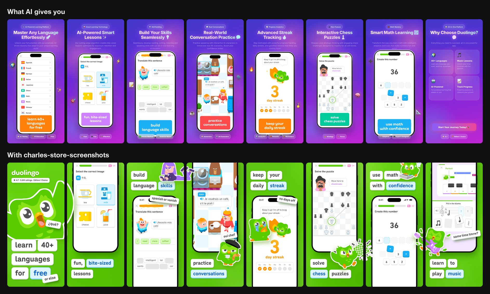
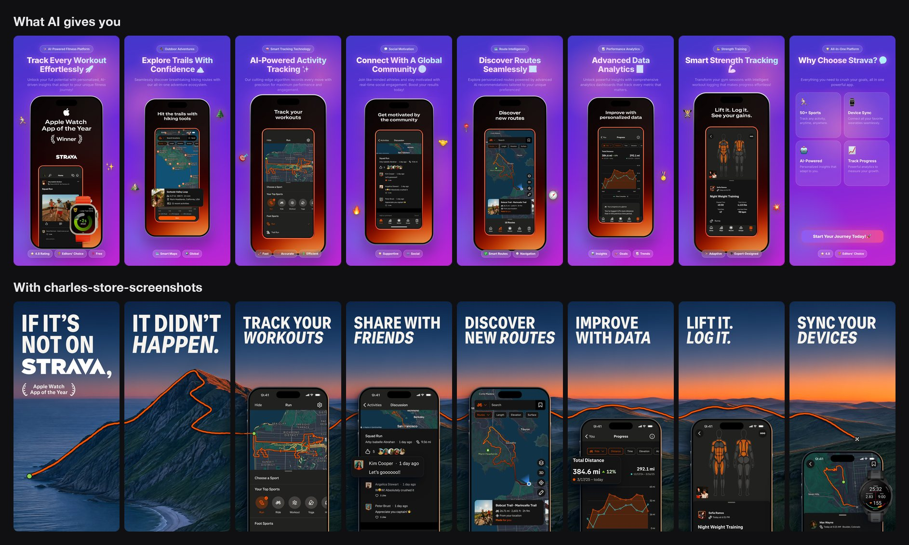
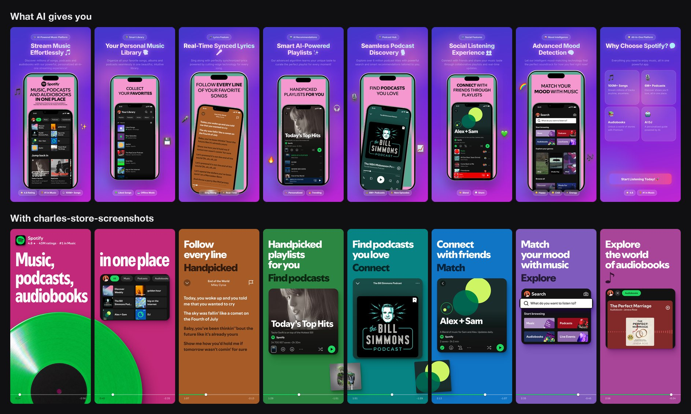
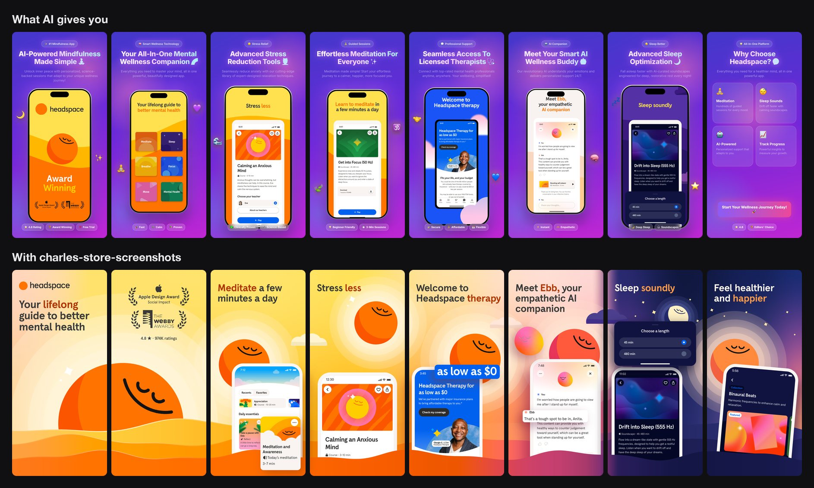

# app-store-screenshots



Designs App Store and Play Store screenshot sets that look like the best ones on the store.

*Part of [husein-skills](https://github.com/huseinaa/husein-skills). Made by **Charles Liu**: the original
lives in [LemonFace0309/charles-skills](https://github.com/LemonFace0309/charles-skills) (MIT, see [LICENSE](LICENSE)).*

## Install

One line (needs [Node.js](https://nodejs.org)):

```bash
npx skills add huseinaa/husein-skills --skill app-store-screenshots -g
```

Or with git:

```bash
git clone https://github.com/huseinaa/husein-skills.git
cd husein-skills
./install.sh app-store-screenshots       # Mac / Linux
powershell -ExecutionPolicy Bypass -File install.ps1 app-store-screenshots   # Windows
```

Or copy this folder into `~/.claude/skills/` (Claude Code) or `~/.agents/skills/` (Codex).

## What it does

- A two-frame hook, and frames that run into each other like one picture
- Your real app UI at its best moment, with the app's real ratings and awards where people decide
- Builds each set in HTML from your captures and photos, renders it at Apple's exact iPhone, iPad and iPhone Duo
  sizes, and checks it at search-result size and seam by seam, so nothing looks cut off by accident

## Examples

Concept sets for apps everyone knows, each built from the app's real App Store captures and its own captions. In each
image, the top row is what AI gives you and the bottom row is the skill's set. These are concepts, not the brands' own.

Duolingo, at the top: headlines spelled in their word buttons, Duo bursting across the first gap, the real 4.7 stars
from 5.6M ratings under the logo, and the mascots in new poses.


Strava: one dusk coastline and one orange route through every frame, their own saying split across the hook, and Apple's
award on top.


Spotify: their lyric colours, headlines set like their lyrics screen, a record under the hook, and covers across the gaps.


Headspace: one sky from sunrise to night, a giant sun face across the hook, and each payoff lifted out of its phone.

## Try it

```text
/app-store-screenshots three App Store screenshot sets for my habit tracker, from the captures in ./shots
/app-store-screenshots critique my current screenshots in ./store
```

## Needs

Python 3 with Playwright, Pillow and requests, and Google Chrome. Generated art and photo cutouts go through
the codex-image MCP (`generate_image`, on your ChatGPT subscription), so no API keys.

## Pairs with

[charles-color-analysis](https://github.com/LemonFace0309/charles-skills) in Charles's repo, to check the palette before you render.

## Credit

By Charles Liu, from [charles-skills](https://github.com/LemonFace0309/charles-skills), MIT licensed. Shared here with
credit by Husein Aboul Hasan, [unemployedhusein.com](https://unemployedhusein.com).
